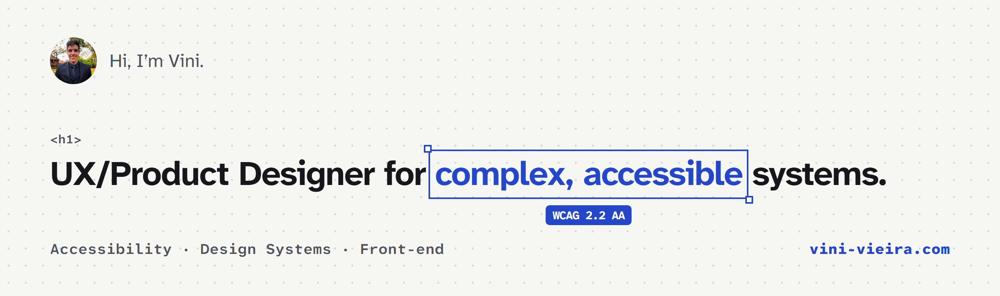
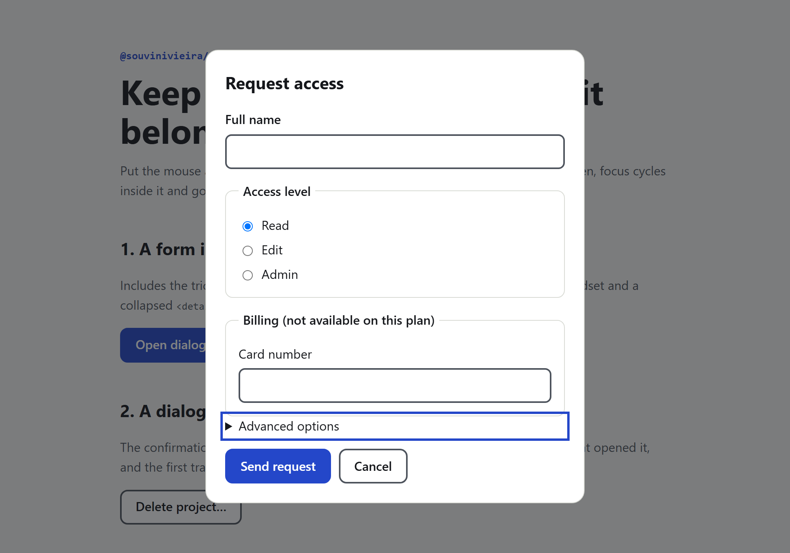
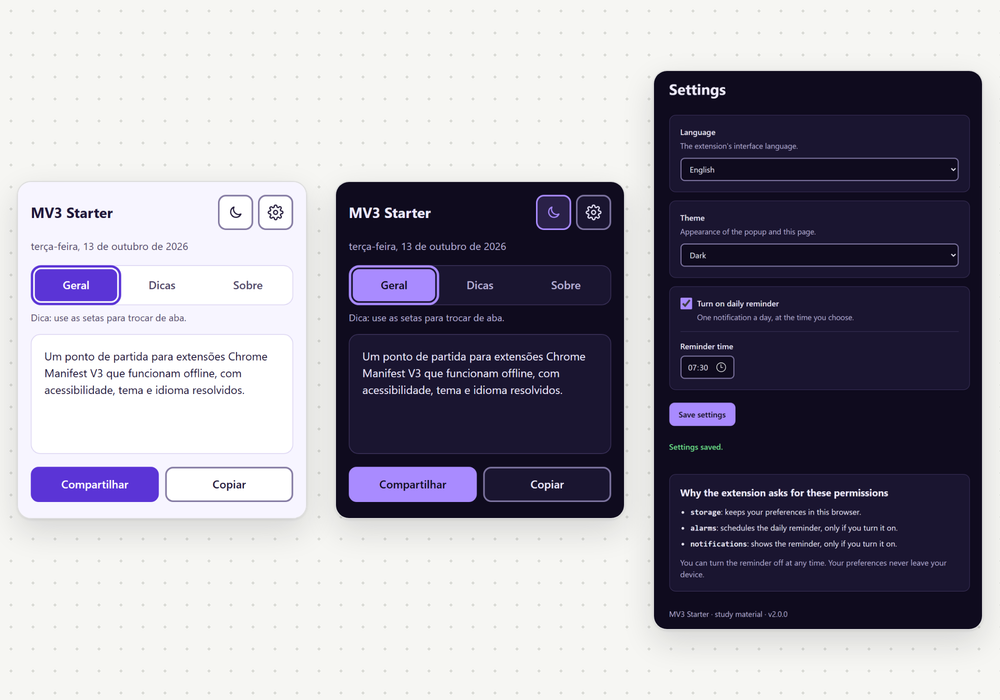

<a href="https://vini-vieira.com">
  <picture>
    <source media="(prefers-color-scheme: dark)" srcset="assets/banner-dark.png">
    
  </picture>
</a>

I currently design for Itamaraty, Brazil's Ministry of Foreign Affairs, at G4F. Before that, Coca-Cola and Instabuy.

I also write front-end code. It shortens the road from Figma to production, and it's how I test accessibility ideas for real instead of only describing them.

**Portfolio:** [vini-vieira.com](https://vini-vieira.com) · **LinkedIn:** [souvinivieira](https://www.linkedin.com/in/souvinivieira/)

## Projects

<table>
  <tr>
    <td width="50%" valign="top">
      
      <h3><a href="https://github.com/SouViniVieira/FocusTrap">FocusTrap</a></h3>
      
A tiny, dependency-free focus trap for accessible dialogs and drawers. Tab order matches the browser, and traps can be nested.

      
<a href="https://souvinivieira.github.io/FocusTrap/">Live keyboard demo</a> · TypeScript, Vitest

    </td>
    <td width="50%" valign="top">
      
      <h3><a href="https://github.com/SouViniVieira/mv3-offline-extension-starter">MV3 offline extension starter</a></h3>
      
A Chrome extension starter that works offline, with accessible tabs, light and dark themes, two languages and a reminder that survives daylight saving time.

      
JavaScript, Manifest V3

    </td>
  </tr>
</table>

**Also:**

- [AutoTamer](https://github.com/SouViniVieira/AutoTamer-ScriptUO): an Animal Taming training script for Ultima Online. It tames, renames and releases creatures without touching the shard's economy. Python, TazUO API.
- **Trechinho:** a platform that summarizes and transcribes videos into text, podcast and topic summaries. React, Node.js, TypeScript, OpenAI, Firebase.

Design case studies, including the design system and the public-sector work, are on [vini-vieira.com](https://vini-vieira.com).

## What I work on

- **Accessibility:** WCAG 2.2 AA from the first sketch, keyboard and screen reader testing, audits.
- **Design systems:** tokens, components and the documentation that keeps teams using them.
- **Complex products:** back offices, forms and workflows for the public sector, where mistakes are expensive.
- **Front-end:** prototypes and production code in TypeScript, React and Vue.

**Tools:** Figma · TypeScript · JavaScript · React · Vue · Node.js · Tailwind CSS · Material UI · Python · Vitest · axe
